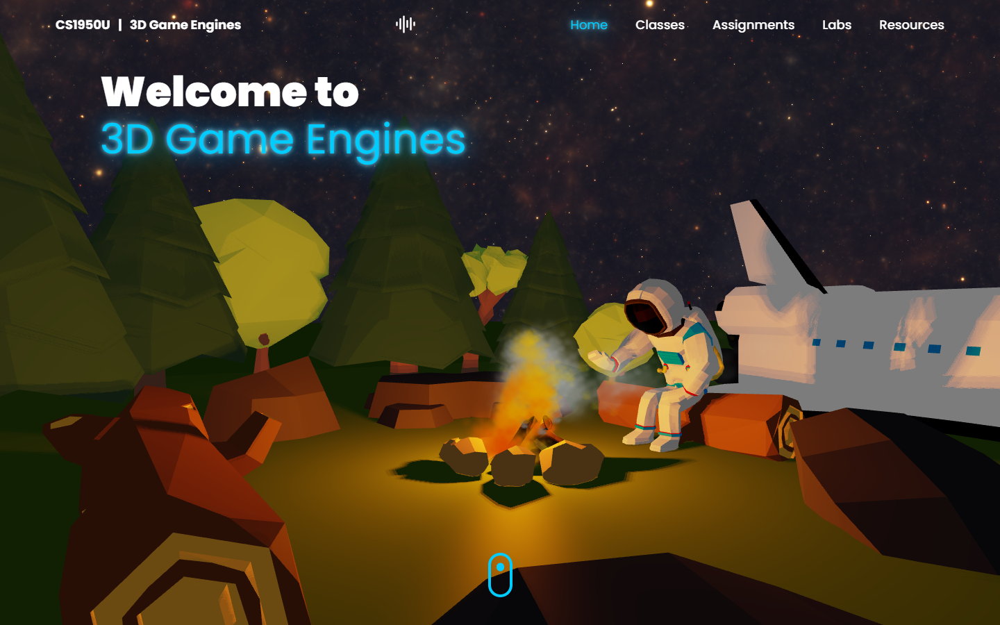
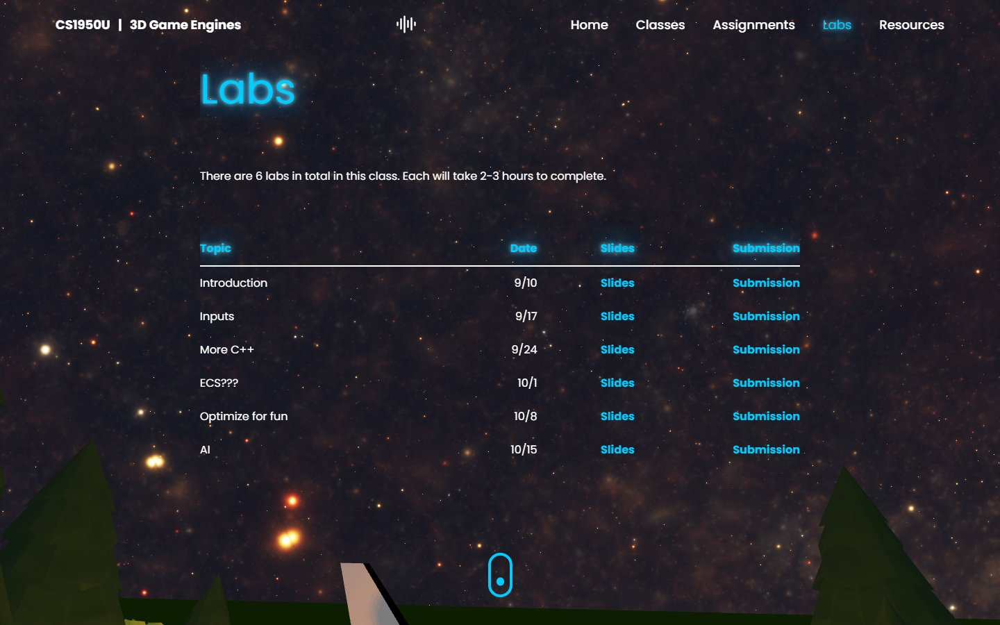

# CS1950U: 3D Game Engines (course website)

The website for **CSCI 1950U: 3D Game Engines** at Brown University, taught by Professor
[Daniel Ritchie](https://cs.brown.edu/people/faculty/dritchi1/). It was designed and built by
[Arman Mohammadi](https://github.com/amoham42), Head TA for the course.

Instead of a static syllabus page, the site opens on a real-time WebGL campfire scene: a low-poly
astronaut warming up by a fire under a procedural starry sky. The course pages (lectures,
assignments, labs, resources) slide in over the scene, and the camera moves between shots as you
navigate.

**Live site: https://amoham42.github.io/CS1950U/**



## The 3D scene

Everything in the hero is rendered with [three.js](https://threejs.org/) in
[`src/components/scene`](src/components/scene):

- **Custom CPU particle system** ([`particleSystem.js`](src/components/scene/particleSystem.js)):
  pooled sprite particles with per-particle lifetime, colour and size ramps, alpha fade, cone-shaped
  emitters, constant forces, and optional curl-noise turbulence. Two emitters drive the fire and the
  smoke.
- **Interactive smoke and fire**: each frame the mouse is raycast into the scene, and an invisible
  sphere at the hit point pushes nearby particles away, so you can wave your cursor through the
  flames.
- **Procedural sky**: a full-screen fragment shader renders a volumetric star field (adapted from
  Kali's *Star Nest* Shadertoy) behind the geometry.
- **Lighting and materials**: a warm orange point light at the fire casts soft PCF shadows; parts
  of the model use a five-step toon ramp (`MeshToonMaterial`), the rest use Phong shading, and the
  whole frame goes through Cineon tone mapping.
- **Camera choreography**: [GSAP](https://gsap.com/) tweens the camera between the campfire shot and
  a sky shot as you switch pages.
- **Ambient audio**: an optional crackling-fire loop, toggled from the navbar and only downloaded
  once you turn it on.

Append `?debug` to the URL (for example
[`/CS1950U/?debug`](https://amoham42.github.io/CS1950U/?debug)) to show the FPS overlay
([stats.js](https://github.com/mrdoob/stats.js)). It is always shown under `npm run dev`.

## Course pages

| Page            | Contents                                                              |
| --------------- | --------------------------------------------------------------------- |
| **Home**        | Course overview, logistics, office-hours calendar, and course staff   |
| **Classes**     | Lecture schedule with slides, code demos, and submission folders      |
| **Assignments** | Project checkpoints (Warmup, Platformer, Final) and due dates         |
| **Labs**        | Weekly labs with slides and submission links                          |
| **Resources**   | Forms, guides, department resources, and reading on engine topics     |

Course data lives in plain JS modules under [`src/constants`](src/constants), so updating the
schedule never means touching component code.



## Tech stack

- [React 18](https://react.dev/) + [Vite 4](https://vitejs.dev/)
- [three.js](https://threejs.org/) (WebGL rendering, glTF loading, raycasting)
- [Tailwind CSS](https://tailwindcss.com/) for layout and styling
- [GSAP](https://gsap.com/) and [Framer Motion](https://www.framer.com/motion/) for animation
- [noisejs](https://github.com/josephg/noisejs) for simplex/curl noise
- Hosted on GitHub Pages

## Getting started

Requires Node.js 18 or newer.

```bash
npm ci          # install dependencies from the lockfile
npm run dev     # start the dev server at http://localhost:5173/CS1950U/
npm run build   # production build into dist/
npm run preview # serve the production build locally
```

The app is served from the `/CS1950U/` base path (set in [`vite.config.js`](vite.config.js)), so
open the URL Vite prints rather than the bare host.

## Deployment

The site is published to the `gh-pages` branch with
[`gh-pages`](https://github.com/tschaub/gh-pages):

```bash
npm run deploy  # runs `npm run build`, then pushes dist/ to the gh-pages branch
```

The build also writes `dist/404.html` (a copy of `index.html`) so deep links such as
`/CS1950U/labs` load the app on GitHub Pages instead of a 404 page.

## Project structure

```text
public/                  static assets (glTF scene, particle texture, audio, staff photos)
src/
  App.jsx                page state, scroll handling, audio toggle
  components/
    scene/main.js        three.js scene: renderer, sky shader, lights, model, render loop
    scene/particleSystem.js  pooled particle system with curl noise
    SplineScene.jsx      mounts the scene and animates the camera between pages
    About.jsx, Classes.jsx, Assignments.jsx, Labs.jsx, Resources.jsx, Table.jsx
  constants/             lectures, labs, projects, and resources data
```

## License

The source code is released under the [MIT License](LICENSE). Course materials linked from or
shown on the site (lecture slides, assignments, schedules, staff photos and bios) belong to the
CSCI 1950U course staff and Brown University and are not covered by that license.
